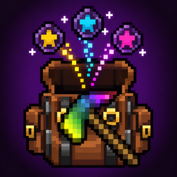

<p align="center"></p>

# VH Tool Forge

A client-side companion for **Vault Hunters** (Minecraft 1.18.2, Forge). It finds every jewel you own, works out which ones build the tool you want, and moves exactly those jewels into a backpack for you.

Nothing is installed on the server and no OP or commands are needed, so it works on any server you can already play on.

[CurseForge](https://www.curseforge.com/projects/1727412) · [Issues](https://github.com/HoYin1600p/VH-Tool-Forge/issues)

## Features

- **Scan your storage.** A **Scan** button appears beside storage screens. It reads every identified jewel's stats, size and level, and remembers where each jewel is.
  - Applied Energistics 2 terminals and Refined Storage grids are read in full, whatever the search box shows.
  - Chests, barrels, Sophisticated Storage, backpacks and other normal containers work too.
- **Describe the tool you want.** Press **,** (comma) to open the planner.
  - Pick the tier (Chromatic Iron to Prismatic) and base type (pick, axe, shovel, hammer or sickle).
  - Enter targets for Mining Speed, Item Quantity, Item Rarity, Trap Disarm, Copiously, Immortality, Durability, Reach and Hammer Size. Each one is the tool's total, base stats included.
  - Rank priorities 1 to N; unranked stats share the lowest weight.
  - Tick must-have yes/no stats (affinities, tool types, Smelting, Pulverizing, Hydrovoid). Soulbound is a nice-to-have.
  - Add unique jewels with their sizes, set a maximum jewel level, and account for the Increased Tool Capacity prestige unlock.
- **See the result first.** Must-haves are covered before anything else, from storage or by reserving room to craft one. The rest of the capacity goes to your targets by priority, without overshooting.
  - **As Entered** and **As Built** previews show real Vault Hunters tooltips. As Built uses Vault Hunters' own jewel application code.
- **Collect it.** Choose a Sophisticated Backpack, open each storage and press **Collect**. The planned jewels move into the backpack one at a time and are ticked off on the Plan tab.
- **Follows your pack.** Tool tiers, unique jewels and Jewel Crafting Table recipes are read from the pack's own `config/the_vault` files.

## Requirements

| | |
|---|---|
| Minecraft | 1.18.2 |
| Loader | Forge 40.x |
| Required | Vault Hunters (tested with Vault Hunters Remastered builds) |
| Needed for Collect | Sophisticated Backpacks |
| Optional | Applied Energistics 2, Refined Storage, JEI (keeps its item list clear of the buttons) |

Install on the **client only**.

## Usage notes

- **,** (comma) opens the planner. You can rebind it under Controls → VH Tool Forge.
- The Scan and Collect buttons can be switched off at the top of the planner.
- The target backpack must be in your main inventory or hotbar while collecting.
- Collecting performs the same clicks you would make, one jewel at a time. Check your server's rules on automated inventory actions if you are unsure.
- Scans and settings are saved per world or server in `config/vhtoolforge/data/`.

## Building

Requires JDK 17. Run:

```
./gradlew build
```

The mod jar is written to `build/libs/`. Nothing needs to be downloaded by hand: the mods it compiles against (Vault Hunters, Applied Energistics 2, Refined Storage, JEI) are fetched from CurseForge through [CurseMaven](https://cursemaven.com), using the file ids in `gradle.properties`.

`./gradlew build` also runs the checks:

- the unit tests (solver, planner rules, pack config parsing);
- `compileAgainstVaultHunters3`, which compiles the mod a second time against the newest regular (non-Remastered) Vault Hunters 3rd Edition file. The main build uses the Remastered line.

To build against a jar that is not on CurseForge, such as a newer pack build, pass its path. This replaces only that dependency: `-Pvault_jar=path/to/the_vault-….jar`. The same works with `-Pae2_jar`, `-Prs_jar` and `-Pjei_jar`.

## License

[LGPL-3.0-or-later](LICENSE). Vault Hunters and the other mods named here belong to their respective authors; this project is not affiliated with them.
